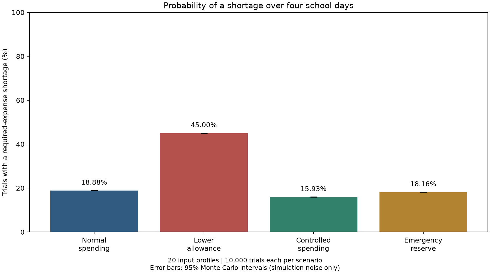
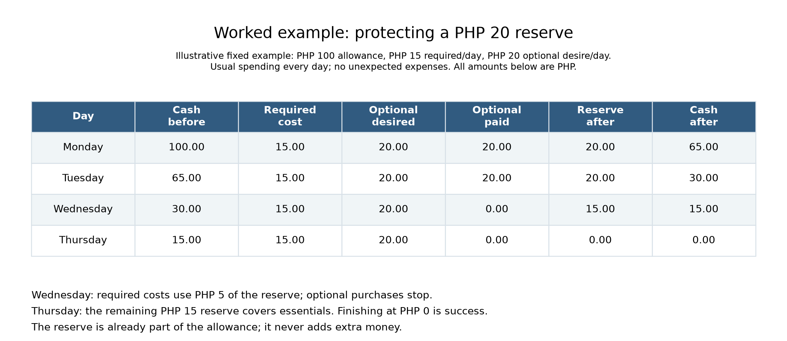

# Student Allowance Monte Carlo Simulation

A Python class project comparing whether students can cover required expenses
from Monday through Thursday under four budgeting scenarios:

| Scenario | Allowance | Desired optional spending | Protected reserve |
|---|---:|---:|---:|
| Normal spending | 100% | 100% | 0% |
| Lower allowance | 80% | 100% | 0% |
| Controlled spending | 100% | 50% | 0% |
| Emergency reserve | 100% | 100% | 20% of allowance |

The reserve is already part of the allowance. Required costs come first; optional
purchases use only unprotected cash. A trial fails when required costs cannot be
fully paid. Exactly covering all four days is success, even with zero ending cash.

**Data note:** the included 20 profiles are AI-adjusted survey inputs. They are
not unchanged verified survey responses. Results describe those profiles under
the model assumptions, not a representative student population.

## Getting started on Windows

1. Install **Python 3.10 or newer**. Enable the Python launcher or add Python to
   PATH during installation.
2. Clone this repository, or download its ZIP from GitHub and **extract it**.
3. Double-click **`setup.bat`**. The first setup requires internet access to
   install the dependencies.
4. Double-click **`run_simulation.bat`**.

Setup creates a `.venv` inside this folder. Virtual environments depend on the
computer and Python installation, so every group member creates their own.
The repository provides `requirements.txt` and setup scripts instead of a copied
environment. After setup, simulation runs use the included workbook locally.

PowerShell commands, run from the repository folder:

```powershell
python setup_env.py
.\.venv\Scripts\python.exe -m unittest -v
.\.venv\Scripts\python.exe simulation.py
```

If Windows uses the Python launcher, run `py -3 setup_env.py` for the first command.
You do not need to activate the virtual environment when using these full paths.

## macOS or Linux

```bash
python3 setup_env.py
.venv/bin/python -m unittest -v
.venv/bin/python simulation.py
```

If the system reports that `venv` or `ensurepip` is missing, install your operating
system's Python virtual-environment package and retry setup.

## What to read

| File | Purpose |
|---|---|
| `simulation.py` | Student profiles, four-day payment rules, repeated trials |
| `analysis.py` | Confidence intervals, paired comparisons, input-fact export |
| `visuals.py` | Three charts and the worked example table |
| `test_simulation.py` | Ten exact cases and five supporting checks |
| `data/Data_20-students.xlsx` | Input workbook; read without modification |
| [Model specification](docs/Project%20Model.md) | Assumptions, research question and experiment design |
| [Rules and tests guide](docs/RULES_AND_TESTS.md) | Explanation of all 15 rules and their test evidence |
| [Coding assessment](docs/CODING_ASSESSMENT.md) | Rubric evidence and remaining report/validation work |

The dependency list is only `openpyxl` and `matplotlib`. Python's standard library
supplies random sampling, CSV output and the statistical helper's arithmetic.

## Outputs and reproducibility

The default experiment uses seed **20261027**, **10,000 trials per profile per
scenario**, and **20 profiles**: **800,000 four-day trials** in total. Edit `SEED`
and `TRIALS` near the top of `simulation.py` to change the experiment.

Running the program creates `results/` containing:

- `results.csv`: results by profile and scenario plus equal-weight overall rows.
- `comparisons.csv`: paired differences from normal spending and 95% Monte Carlo intervals.
- `input_facts.csv`: 140 numerical model attributes with units and source cells.
- `comparison.png`, `remaining_cash.png`, `first_shortage_day.png`: the three charts.
- `worked_example.png`: a fixed Monday-Thursday reserve example.
- `run_settings.txt`: seed, generator and trial settings.

`sample_results/` includes a previously generated full run so your group can read
the outputs before installing Python. New runs go to `results/`, which Git ignores.
CSV probabilities are fractions; risk differences labeled `pp` are percentage
points. Money outputs are PHP. Close generated CSV files in Excel before rerunning.





## Verification and limitations

Expected test result: **15 tests pass**. Tests cover exact coverage, early failure,
required/optional priorities, reserve depletion, random thresholds, input
validation, statistical calculations, source-cell tracing, and a full reproducible
run that produces every visual.

Confidence intervals describe **simulation noise conditional on the profiles and
assumptions**. They do not measure the accuracy of AI-adjusted data or establish
external validation. The rule guide explains the formula and paired comparisons.
The final report, independent validation and the instructor's assessment of the
highest rule-complexity band remain separate from successful program execution.
Broader sensitivity experiments in the model specification are outside this
simple package's automatic run.

## Uploading this folder to GitHub

Copy the **contents of this folder** into your repository. Include the source,
`data/`, `docs/`, `sample_results/`, setup scripts, `requirements.txt` and `.gitignore`.
Do **not** upload `.venv/`, `__pycache__/`, or generated `results/`. With Git, the
included `.gitignore` handles those exclusions. With browser drag-and-drop uploads,
leave those folders out manually. Your friends run setup after downloading.
