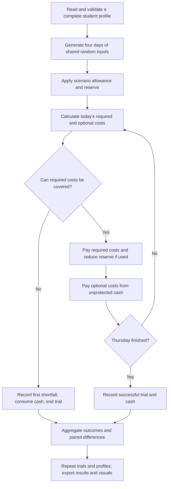

# How to explain and verify the simple simulation

This guide concerns the Python simulation, not a completed project report.
The included `Project Model.md` supplies the model assumptions. Python acceptance
was confirmed in the project discussion. Rule evidence below describes actual
budget decisions, not a count of functions or lines.

## The 15 model rules

| Rule | Behavior and implementation in simulation.py | Evidence |
|---|---|---|
| R1 | `simulate_week` credits allowance once before the day loop; there are no later inflows. | Cases 1-4: balance falls only through expenses. |
| R2 | `load_students` stores one complete student's amounts together; `main` simulates each profile separately. | Fact source checks; each profile has seven traceable numerical attributes. |
| R3 | `spending_multiplier` selects one daily condition; `simulate_week` applies it to food and optional demand, leaving transport fixed. | Case 10 checks interval boundaries; case 9 checks the usual condition. |
| R4 | `simulate_week` uses `divmod` to allocate supplies; the first remainder days receive one extra centavo. | Case 8 checks a PHP 1.03 total exactly. |
| R5 | `simulate_week` converts four-week event count K into daily probability K/16. | Case 10 tests the exact .0625 boundary for K=1. |
| R6 | `simulate_week` charges the usual event cost only if the event draw is strictly below its probability. | Case 10 compares triggered, non-triggered, and zero-count paths. |
| R7 | `pay_day` considers all required costs before optional purchases. | Cases 4-7. |
| R8 | `pay_day` lets required costs use reserve funds when ordinary cash is insufficient. | Case 6; case 9 Wednesday/Thursday. |
| R9 | `pay_day` reduces reserve to the minimum of previous reserve and post-required cash; it never restores a used reserve. | Case 9 checks reserve progression 20,20,15,0. |
| R10 | `pay_day` caps optional payment by cash outside the reserve and by desired spending. | Cases 5 and 7. |
| R11 | Scenario settings reduce allowance to 80% without changing the generated expense inputs. | Case 8; same draws in the paired experiment. |
| R12 | Scenario settings reduce optional desire to 50% without reducing required needs. | Case 9: normal fails; controlled succeeds. |
| R13 | `pay_day` records the first shortfall and consumes available cash; `simulate_week` stops that trial immediately. | Cases 3-4; case 4 checks that later demand is not counted. |
| R14 | `pay_day` uses `required > balance`: exact coverage succeeds; unaffordable optional desire alone is not failure. | Cases 2,5,8,9. |
| R15 | `cents`, `validate_student`, and `load_students` reject invalid inputs; inconsistent reserves/ranges produce review warnings without silently changing data. | Case 8 and the input-rejection supporting check. |

The reasoning is a sequence of interacting conditions: scenario settings establish
funds and optional demand; required payment determines whether the reserve is used;
the reduced reserve determines optional affordability; today's balance becomes
tomorrow's state; a first essential shortfall ends further decisions. This is the
substantive chaining evidence for the rule-complexity criterion. There is no
artificial recursion or a separate generic rule engine. Whether this reaches the
rubric's highest "advanced logic" band remains an assessment by the instructor.

## Exact cases and expected outputs

Run `.\.venv\Scripts\python.exe -m unittest -v` from the repository root.
The ten `VerificationCases` methods match the ten cases in the shared model.
Amounts below are PHP; multipliers are 1 and events absent unless specified.

| Case | Setup | Expected output |
|---|---|---|
| 1 | A=100; all costs=0 | Success; Thursday cash=100. |
| 2 | A=100; required=25/day | Success; Thursday cash=0. |
| 3 | A=99; required=25/day | Thursday is first shortage; shortfall=1; cash=0. |
| 4 | A=20; Monday required=25 | Monday shortage=5; terminate; no later optional demand. |
| 5 | Cash=100; reserve=0; required=10; optional desire=200 | Optional paid=90; no required shortfall that day. |
| 6 | Cash=100; reserve=20; required=85; optional desire=10 | Cash=15; reserve=15; optional paid=0. |
| 7 | Cash=100; reserve=20; required=30; optional desire=60 | Optional paid=50; cash=20; reserve=20. |
| 8 | A=100; required=20/day | Normal cash=20; lower-allowance cash=0; both succeed. |
| 9 | A=100; food=15/day; optional=20/day | Normal first fails Thursday by 15; controlled and reserve finish successfully at 0. |
| 10 | K=1; event cost=100 | U=.0624 triggers the expense; U=.0625 does not. |

Five additional supporting checks cover input rejection, a hand-calculated
confidence interval, paired comparison signs/covariance, source-cell/fact checks,
and a complete reproducible program run that creates all four visuals. These
checks complement the ten required cases rather than replacing them.

## Facts and assumptions

`results/input_facts.csv` contains 140 unique attributes: 20 profiles times seven
numerical model inputs. Every fact has a stable ID, student ID, unit, workbook
cell, and provenance. Allowance and regular supplies are four-day totals; food,
transport, and optional amounts are daily; K counts events over 16 campus days;
event cost is PHP per event. Exported money is PHP, while code stores centavos.

This documents and checks faithful representation of the adjusted workbook.
It does not establish that the modified values accurately describe real students.
Scenario percentages and daily multiplier probabilities are assumptions, not
additional surveyed facts, and are not counted toward the 140 attributes.

## Statistical analysis in plain language

Each profile receives the same trial count, so its contribution to the overall
result is equal. `analysis.py` calculates a 95% normal Monte Carlo interval using
the variance within each fixed profile. For m profiles, estimated mean variance
is `sum(sample_variance_i / trials_i) / m^2`. This accounts for fixed profile
allocation rather than pretending that 200,000 different students were surveyed.

For scenario differences, the code subtracts normal from the alternative within
the same repetition. Both outcomes use exactly the same random inputs. The
variance of those paired differences retains their covariance; subtracting two
unrelated interval endpoints would not do this. `comparisons.csv` reports risk
differences in percentage points and cash differences in PHP, by student and
overall. Negative risk differences mean fewer shortages. Identical paired
policies have zero difference variance, which a test verifies.

Intervals describe random simulation error conditional on the inputs and
assumptions. They do not measure the reliability of AI-adjusted survey values or
uncertainty about a student population. No observed variation can give a zero-width
normal interval; this is not proof that a real-world event is impossible.

## Flow of the program

The student is the entity; day, cash, protected reserve, and first shortage are
state variables. Spending conditions and unexpected costs are random events.
`simulation.py` handles their day-to-day transitions; `analysis.py` summarizes
outcomes; `visuals.py` displays them; `test_simulation.py` verifies the behavior.

## What still belongs in the final report

Use the outline's ten sections for the project overview, objectives, model,
data collection/input assumptions, implementation, verification/validation,
results/trade-offs/recommendations, labeled outputs, IEEE references, and code
listing. Tests verify the implementation. Independent historical comparison or
documented expert review is still needed to substantiate real-world validation.
No such review is invented or implied by these outputs. The original model also
specifies broader sensitivity experiments. They are outside this simple package;
this implementation does not claim to run that entire experimental plan.
